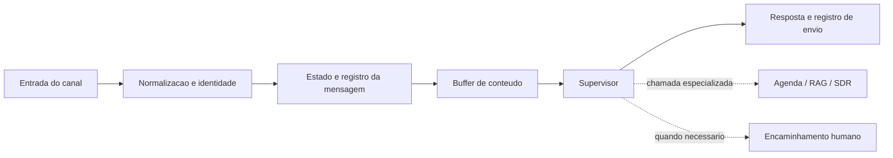

# Atendimento com IA, estado e continuidade

Estudo técnico dos workflows de atendimento da Neovian para WhatsApp e Instagram. A parte central do trabalho é coordenar mensagens, identidade, contexto comercial e passagem para uma pessoa sem transformar cada interação em um cadastro ou uma ação duplicada.

O sistema combina n8n, modelos de linguagem, Redis, Postgres/Supabase e integrações de canal. O Supervisor recebe contexto consolidado e pode chamar ferramentas especializadas; persistência, agenda e handoff têm responsabilidades próprias.

Este repositório documenta a arquitetura encontrada em exports locais. Ele não contém uma cópia executável da operação nem apresenta a leitura estrutural como prova de funcionamento em produção.

## Dois canais, contratos diferentes

| Canal | Entrada e identidade | Continuidade |
| --- | --- | --- |
| WhatsApp | Evento Evolution, normalização do contato e resolução de identidade antes do processamento principal. | Activities, buffer Redis, contexto CRM e compatibilidade temporária com estruturas legadas. |
| Instagram | Evento Meta, identidade externa do remetente e chamada RPC de resolução de identidade. | Claim de evento antes de IA/envio, activities, Redis e estados separados de pausa e handoff; atomicidade e durabilidade dependem do backend ainda não revalidado. |

O diagrama resume responsabilidades. As diferenças entre canais e as dependências ainda não comprovadas estão em [arquitetura](docs/architecture.md).

## Decisões que aparecem nos fluxos

- **Resolver identidade antes de escrever histórico.** O lead interno e a identidade do canal têm papéis distintos.
- **Agrupar mensagens antes de responder.** Redis consolida conteúdo; ele não substitui a deduplicação durável do evento.
- **Separar decisão e efeito.** O Supervisor decide a próxima ação, enquanto ferramentas e blocos operacionais executam responsabilidades específicas.
- **Registrar outbound depois do envio.** Há caminhos de confirmação e registro, com cobertura de erro diferente por canal.
- **Dar ao humano uma fila durável.** No subworkflow de handoff inspecionado, a tarefa comercial vem antes do marcador de sucesso e da notificação Slack.

## Evidência disponível

A inspeção de 08/10/2026 encontrou 151 nodes no workflow WhatsApp, 133 no Instagram, 9 no Calendar Instagram e 27 no handoff compartilhado. Esses quatro exports passaram no parse JSON e na verificação de destinos das conexões. Isso confirma a estrutura local, não as credenciais, o schema ativo ou o resultado de uma conversa real.

As chamadas de RAG e SDR estão presentes, mas os respectivos subworkflows não foram encontrados no acervo inspecionado. Há também ambiguidade de versões do Calendar e um destino de encaminhamento que não foi comprovado como o handoff compartilhado disponível. Essas fronteiras estão documentadas em [estado e critérios de validação](docs/verification.md).

Um recorte offline de classificação de conteúdo está disponível no repositório [automation-workflows](https://github.com/ogsousa/automation-workflows). Ele serve para estudar uma etapa do pipeline com entradas sintéticas, sem reproduzir a operação privada.
