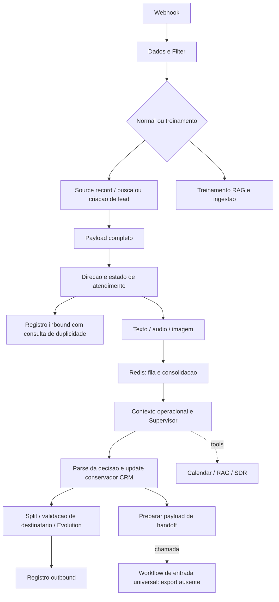
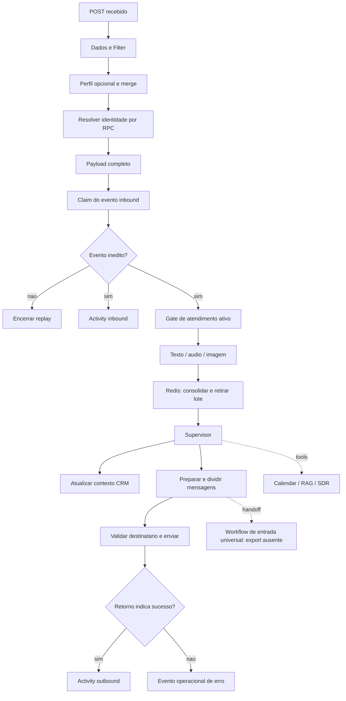
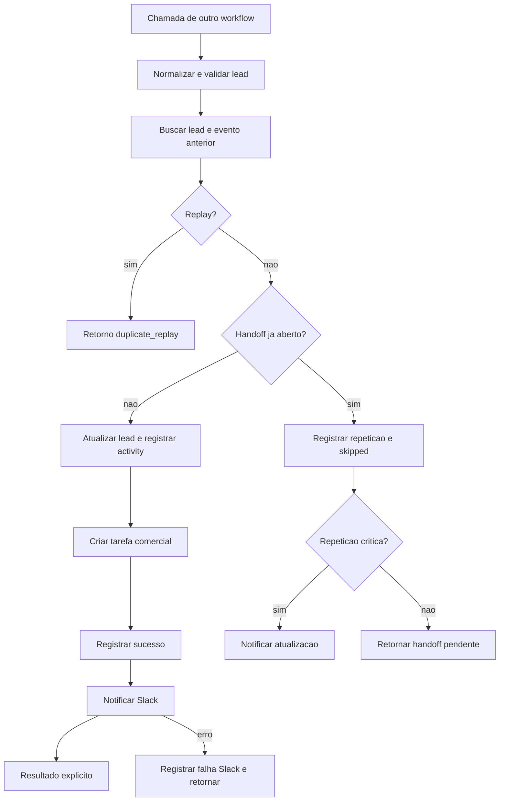

# Arquitetura observada

Os diagramas abaixo representam conexões e responsabilidades observadas nos exports locais, com detalhes agrupados para facilitar a leitura. Linhas pontilhadas indicam ferramentas ou vínculos cuja implementação completa não foi comprovada nesta auditoria.

## WhatsApp / Evolution

O caminho atual inclui `leads`, `lead_source_records`, `activities` e `operational_sync_events`. Gates de compatibilidade preservam `contatos_whatsapp` e `historico_whatsapp` para fallback. O estado legado ainda aparece nos nodes de pausa e no caminho de handoff: não se trata de uma migração completamente encerrada.

A deduplicação de activities observada usa lookup seguido de insert. O grafo, isoladamente, não prova exclusão mútua sob concorrência. O node de envio não apresenta uma saída dedicada de erro no export; falhas de transporte precisam de validação própria.

## Instagram DM / Meta

`Resolver Identidade CRM` e `Claim Evento Inbound` estão presentes como chamadas RPC. A documentação local associa a primeira à identidade transacional e a segunda a `crm_domain_events`. Não foi consultado o banco nesta auditoria; atomicidade e permissões atuais continuam dependentes de validação do backend.

O POST do export responde ao receber o evento. Um webhook GET separado atende à verificação do canal. O mapeamento atual lê somente a primeira entrada e a primeira mensagem do envelope.

O grafo contém também treinamento e ingestão RAG, além de nodes antigos desconectados. A existência desse bloco não comprova o funcionamento do subworkflow de consulta RAG.

## Calendar: subworkflow observado, versão a confirmar

O subworkflow Instagram contém um agente, um modelo e seis ferramentas Google Calendar: criar, atualizar, excluir, listar, ler e consultar disponibilidade. Não há escrita em `meetings` nesse export.

As regras documentadas distinguem uma nova reunião de consulta, reagendamento e cancelamento. A confirmação deve depender do resultado da ferramenta. A ferramenta de exclusão permanece diretamente disponível ao agente; um executor determinístico com alvo validado é uma melhoria pendente.

Um segundo export Calendar foi encontrado no acervo local com a mesma identidade técnica referenciada pelos chamadores. Os nomes em cache diferem entre WhatsApp e Instagram. Isso impede afirmar que cada canal utiliza hoje uma versão própria e correta em produção.

## Handoff compartilhado: módulo observado separadamente

A tarefa é a fila durável; a notificação é posterior. Existem saídas explícitas para identidade ausente, lead não encontrado, replay, erro CRM e erro Slack.

Os chamadores inspecionados referenciam um workflow de entrada universal. A correspondência desse destino com o módulo compartilhado acima não foi comprovada. Portanto, o diagrama não atribui ao atendimento uma integração concluída com este subworkflow.

## RAG e SDR

Ambos os canais possuem tools denominadas `RAG_agent` e `SDR_agent`, conectadas ao Supervisor. Os subexports correspondentes não foram encontrados no conjunto inspecionado. A documentação descreve consulta de conhecimento e descoberta comercial, mas implementação, contratos completos, prompts internos e resultados dessas dependências permanecem fora da evidência disponível.
